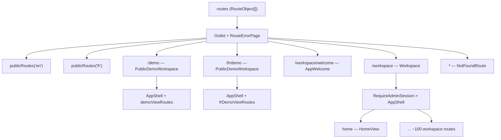
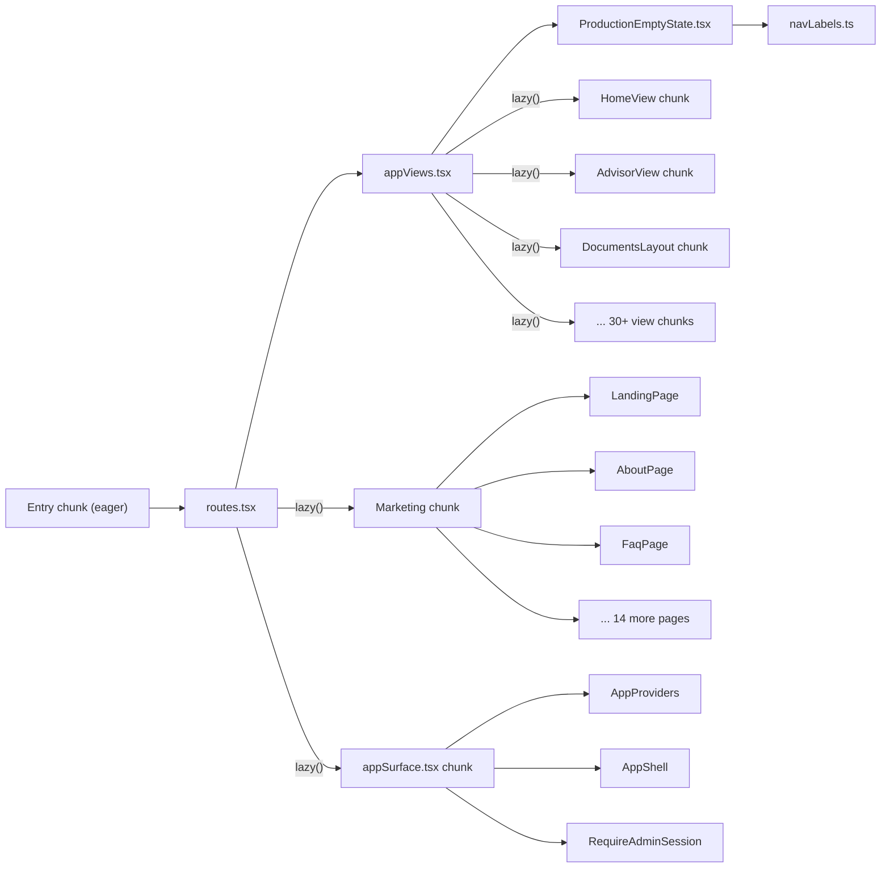
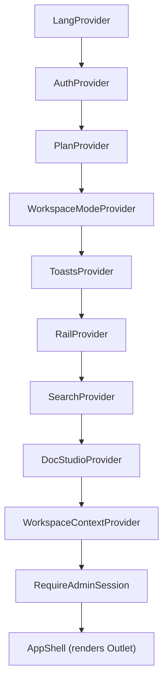
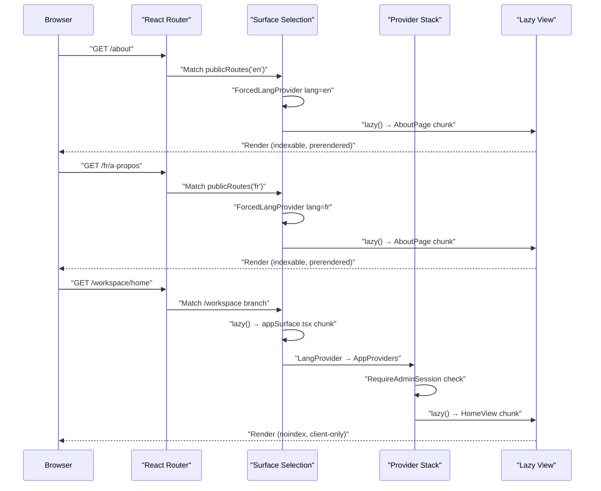

# Routing & Code Splitting

<details>
<summary>Relevant source files</summary>

The following files were used as context for generating this wiki page:

- [src/app/appViews.tsx](src/app/appViews.tsx)
- [src/app/routes.tsx](src/app/routes.tsx)
- [src/features/app/documents/DoclibProvider.test.tsx](src/features/app/documents/DoclibProvider.test.tsx)
- [src/features/app/documents/DoclibProvider.tsx](src/features/app/documents/DoclibProvider.tsx)
- [src/features/app/documents/components/SignatureModal.tsx](src/features/app/documents/components/SignatureModal.tsx)
- [src/features/app/documents/components/SignaturePad.tsx](src/features/app/documents/components/SignaturePad.tsx)
- [src/features/app/documents/doclibContext.ts](src/features/app/documents/doclibContext.ts)
- [src/features/app/documents/screens/DocumentDetailScreen.tsx](src/features/app/documents/screens/DocumentDetailScreen.tsx)
- [src/features/app/documents/screens/SigningScreen.tsx](src/features/app/documents/screens/SigningScreen.tsx)
- [src/features/app/shell/EntryStage.tsx](src/features/app/shell/EntryStage.tsx)
- [src/features/marketing/pages/NotFoundPage.test.tsx](src/features/marketing/pages/NotFoundPage.test.tsx)
- [src/features/marketing/pages/NotFoundPage.tsx](src/features/marketing/pages/NotFoundPage.tsx)
- [src/features/marketing/sections/Footer.tsx](src/features/marketing/sections/Footer.tsx)
- [src/features/marketing/sections/WorkspaceModuleDemos.tsx](src/features/marketing/sections/WorkspaceModuleDemos.tsx)
- [src/seo/routes.ts](src/seo/routes.ts)
- [src/seo/seo.test.ts](src/seo/seo.test.ts)

</details>

The Dutiva application uses a **three-surface route architecture** that separates the public marketing website, the public read-only demo, and the authenticated app workspace. Each surface has its own language strategy, rendering model, SEO posture, and code-splitting boundary. The route system is built on React Router v7 (`react-router-dom`) with `RouteObject[]` arrays, and every view is lazily loaded via `React.lazy()`.

## Three-Surface Architecture Overview

**High-level route map:**



Sources: [src/app/routes.tsx:133-175](<>), [src/app/routes.tsx:50-63](<>), [src/app/routes.tsx:71-99](<>)

The three surfaces differ fundamentally:

| Aspect            | Marketing                              | Public demo                                              | App workspace                      |
| ----------------- | -------------------------------------- | -------------------------------------------------------- | ---------------------------------- |
| URL prefix        | `/` (EN), `/fr/…` (FR)                 | `/demo`, `/fr/demo`                                      | `/workspace/…`                     |
| Language strategy | URL-scoped (`ForcedLangProvider`)      | URL-scoped (`ForcedWorkspaceLangProvider`)               | Preference-scoped (`LangProvider`) |
| SEO               | Indexable, prerendered, canonical URLs | Demo index prerendered; subpaths `noindex` via app shell | `noindex`, client-rendered         |
| Auth              | None                                   | None (read-only)                                         | `RequireAdminSession` gate         |
| i18n catalogue    | Marketing messages only                | Full workspace catalogue                                 | Full workspace catalogue           |
| Code chunk        | Marketing lazy chunk                   | App lazy chunk (`appSurface.tsx`)                        | App lazy chunk (`appSurface.tsx`)  |

Sources: [src/app/routes.tsx:13-15](<>), [src/app/appSurface.tsx:6-12](<>), [src/i18n/ForcedLangProvider.tsx:22-57](<>)

## The Route Table: `src/app/routes.tsx`

The root route array is defined in `routes.tsx`. A pathless root wraps all routes in a single error boundary via `RouteErrorPage`:

```
routes = [{ element: <Outlet />, errorElement: <RouteErrorPage />, children: routeTree() }]
```

[src/app/routes.tsx:133-142](<>)

`routeTree()` returns these top-level branches (in source order):

1. **`publicRoutes('en')`** — English marketing pages
2. **`publicRoutes('fr')`** — French marketing pages with localized slugs
3. **`/workspace/welcome`**, **`/workspace/auth/confirm`** — Auth entry points (outside the gated shell)
4. **`/sign/:token`**, **`/fr/sign/:token`** — External signing (no login)
5. **`/demo`**, **`/fr/demo`** — Public read-only demo workspace
6. **`/workspace`** — Authenticated workspace shell with nested view routes (`appViewRoutes`)
7. **`/careers`** (EN + `/fr/carrieres`) — `CareersSurface`: public job board with `jobs/:postingId` leaf
8. **`/employer`** (EN + `/fr/employeur`) — `EmployerDoorPage`: employer door whose sign-in leads into `/workspace`
9. **`/careers/portal`** — Candidate portal (own shell, profile/applications/AI-tools/jobs)
10. **`/invest`** — Standalone invest portal (`invest_access` grant, own shell; public `legal/:slug` leaf)
11. **`/wellness`** — Standalone wellness portal (`health_access` grant, own shell; public `legal/:slug` leaf)
12. **`/pr`** — Standalone PR desk (`pr_access` grant, own shell; public `legal/:slug` leaf)
13. **`*`** — Catch-all 404

The three standalone portals (`/invest`, `/wellness`, `/pr`) each mount a lazily-composed surface (`InvestPortalSurface`, `HealthPortalSurface`, `PrPortalSurface`) that shares `AuthProvider`/`LangProvider`/`ToastsProvider` but renders its own portal layout — separate from both marketing chrome and the `/workspace` sidebar. See [Portal Assistants](Portal-Assistants).

[src/app/routes.tsx:144-175](<>)

### Public Route Generation

The `publicRoutes(lang)` function builds a `RouteObject` for a given locale. Pathnames are derived from the `SEO_ROUTES` registry via `seoRoute(id).path[lang]`, making the registry the **single source of truth** for all public URLs:

```
const p = (id: SeoRouteId) => seoRoute(id).path[lang]
```

[src/app/routes.tsx:71-72](<>)

Each locale tree is wrapped in a `PublicShell` that provides `ForcedLangProvider` and a lazy `ConsentBanner`:

[src/app/routes.tsx:50-63](<>)

The 21 static `SeoRouteId` values are: `home`, `about`, `faq`, `blog`, `pricing`, `templates`, `guides`, `templateUsage`, `knownLimitations`, `legal`, `help`, `contact`, `status`, `changelog`, `vsHrdownloads`, `vsSixfifty`, `jurisdictionTool`, `demoWorkspace`, `careers`, `investors`.

[src/seo/routes.ts:29-43](<>)

Dynamic sub-routes use `:slug` params for blog articles (`/blog/:slug`), guide articles (`/guides/:slug`), legal policies (`/legal/:slug`), and help articles (`/help/:slug`).

[src/app/routes.tsx:81-94](<>)

### App Surface Entry Points

The `/workspace` branch is split into three lazy entry points, all loaded from `appSurface.tsx`:

| Route                     | Export           | Purpose                                               |
| ------------------------- | ---------------- | ----------------------------------------------------- |
| `/workspace/welcome`      | `AppWelcome`     | Sign-in gate (EntryStage)                             |
| `/workspace/auth/confirm` | `AppAuthConfirm` | Magic-link token verification                         |
| `/workspace`              | `Workspace`      | Main workspace shell (gated by `RequireAdminSession`) |

[src/app/routes.tsx:148-172](<>), [src/app/appSurface.tsx:31-68](<>)

The `Workspace` export wraps `AppShell` inside `RequireAdminSession`, which bounces unauthorized visitors to `/workspace/welcome`. Without Supabase configured (local dev), it's a no-op. On Vercel preview deployments, the gate is also skipped.

[src/features/app/auth/RequireAdminSession.tsx:33-53](<>)

## Code Splitting Strategy

**Diagram: lazy boundary architecture mapping code entities to chunk boundaries:**



Sources: [src/app/routes.tsx:16-44](<>), [src/app/appViews.tsx:26-69](<>)

### React.lazy() Pattern

Every view uses a consistent named-export `React.lazy()` pattern. Because the codebase uses named exports (not default exports), each `lazy()` call re-maps the import:

```typescript
const HomeView = lazy(() =>
  import('@/features/app/views/home/HomeView').then((m) => ({ default: m.HomeView })),
)
```

[src/app/appViews.tsx:26](<>)

This pattern is applied to all 185+ lazy components across both `routes.tsx` (marketing + portal pages) and `appViews.tsx` (workspace views). `Suspense` boundaries use `fallback={null}` — each surface paints its own background via CSS surface classes, so there is nothing to flash.

[src/app/routes.tsx:14-15](<>)

### Entry Graph Budget Enforcement

The `check-entry-graph.mjs` CI script enforces that the eager entry graph (what marketing visitors download before anything is interactive) stays within strict budgets:

| Budget         | Ceiling | Purpose                        |
| -------------- | ------- | ------------------------------ |
| `MAX_PRELOADS` | 9       | Maximum modulepreload links    |
| `MAX_EAGER_KB` | 420     | Maximum raw kB of eager chunks |

[scripts/check-entry-graph.mjs:48-49](<>)

The script reads source maps from the built output and checks membership against several barred lists:

- **`BARRED_PACKAGES`**: `react-markdown` tree, `@supabase`, `recharts`/`d3-*` — none may appear in the eager graph
- **`ALLOWED_APP_MODULES`**: Only 4 workspace modules are permitted in the eager graph: `navLabels.ts`, `ModeGate.tsx`, `ProductionEmptyState.tsx`, `workspaceModeContext.ts`
- **`src/data/`**: Demo fixture data must never leak into marketing chunks
- **`PROSE_MODULES`**: Article body content (blog, guide, help) must stay lazy

[scripts/check-entry-graph.mjs:57-103](<>)

This guard exists because `appViews.tsx`'s route objects are built at module scope — whatever they reference directly is eager by construction. A previous incident pulled 113kB of demo fixtures into the eager graph when `ModeGate` imported `navConfig` (which value-imports `@/data`). The fix was to extract `navLabels.ts` as a pure module with no fixture dependencies.

[src/features/app/shell/navLabels.ts:9-17](<>), [scripts/check-entry-graph.mjs:10-13](<>)

### Vite Chunk Splitting Configuration

The `vite.config.ts` configures `codeSplitting.groups` to control chunk boundaries:

| Group Name           | Contents                                                                                                    | Purpose                                  |
| -------------------- | ----------------------------------------------------------------------------------------------------------- | ---------------------------------------- |
| `tour-stop-preview`  | `TourStopPreviewBody.tsx` + `tourStopDemoFixtures.ts`                                                       | Demo-tour previews keep their own chunk  |
| `messages-marketing` | 13 pure-marketing i18n modules (`marketing`, `pricing`, `faq`, `blog`, …)                                   | Marketing catalogue chunk                |
| `messages-shared`    | `shared`, `support`, `helpCenter` i18n modules                                                              | Dual-surface catalogue chunk             |
| `messages-workspace` | Everything else under `src/i18n/messages/` except `shell`, `workspaceMode`, `common`, `seoMeta`, `landing/` | Lazy — only the app surface needs them   |
| `vendor`             | Whitelist of the eager runtime core (`react`, `react-dom`, `react-router-dom`, `scheduler`, `web-vitals`)   | Shared vendor chunk with long cache life |

The `vendor` group is a **whitelist**, not a catch-all — every other package (`@supabase`, `react-markdown`, `recharts`/`d3`, `pdf-lib`, `docx`, `@huggingface/transformers`, zod, lucide icons only workspace screens use) follows its importers and stays off the marketing landing path. `landing/*` leaf modules are deliberately ungrouped too — they follow their importers (LandingPage/PricingPage scopes, workspace catalogue via `shared.ts`).

Both message groups set `includeDependenciesRecursively: false` — otherwise rolldown would pull each module's whole import subtree into the chunk (`marketing.ts → shared.ts → common.ts + landing/*`), re-capturing the eager chrome modules and pinning the chunk onto every page. The `messages-workspace` test excludes `shell.ts`, `workspaceMode.ts`, `common.ts`, `seoMeta.ts`, and `landing/` because they belong in the eager graph or follow their own importers.

[vite.config.ts:171-252](<>)

### Intent Prefetch and Idle Warm-Up

Code splitting only helps if the next chunk arrives before the user needs it. Because every `Suspense` boundary renders `fallback={null}`, a cold chunk shows a blank panel — so the shell warms chunks on **nav intent** (hover / focus / touchstart) and during **browser idle**.

Two modules implement it. `src/app/viewPreloads.ts` holds only the per-view `preload*View()` thunks that `appViews.tsx`'s `lazy()` calls need — it is reachable from the eager entry graph (`routes.tsx` → `appViews.tsx`), so nothing else may live there. `src/app/viewPrefetchRegistry.ts` holds the four flat lookup maps, each entry an `import()` over the same specifier string the matching `lazy()` uses (identical specifiers share the chunk):

| Registry                | Key shape                                  | Coverage                                                                                                                                                                                     |
| ----------------------- | ------------------------------------------ | -------------------------------------------------------------------------------------------------------------------------------------------------------------------------------------------- |
| `workspaceViewPreloads` | `NavItem.key` (`cases`, `finance`, …)      | All 23 sidebar modules. Drill-in chunks ride along — e.g. `cases` also warms `cases.detail`, `hiring` warms candidate and job-posting details.                                               |
| `screenViewPreloads`    | `module.tab` / `view.detail`               | Every multi-screen module tab (comms, finance, revenue, governance, security, operations, specialists), documents screens, support screens, planning/settings sub-tabs, memory detail pages. |
| `portalViewPreloads`    | `portal.page` (`invest.chat`, `pr.seo`, …) | Every page of the invest, health, PR, and careers portals.                                                                                                                                   |
| `marketingViewPreloads` | `mkt.<page>`                               | Header destinations — including `mkt.app`, which warms the entire workspace surface chunk behind the Sign-in CTA.                                                                            |

`src/app/viewPrefetch.ts` resolves all four maps through one deduplicated registry and exposes:

- `prefetchView(key)` — fetch once per key; a failed fetch resets so retries work.
- `viewIntentProps(key)` — `{ onMouseEnter, onFocus, onTouchStart }` for `.map()` loops (no hooks); `usePrefetchIntent(key)` is the single-link variant used by `SidebarNavItem`/`MobileNav`.
- `warmViewsOnIdle(keys)` — warms one chunk per `requestIdleCallback` slice (4s timeout; `setTimeout` fallback on Safari), cancellable via the returned cleanup.
- `portalNavKey(to)` — maps a portal path to its key (`/invest/chat` → `invest.chat`, `/careers/portal/profile` → `careers.profile`).

Both paths respect `navigator.connection.saveData` and `effectiveType` `2g`/`slow-2g` — constrained clients prefetch nothing.

Wiring: `SidebarNavItem`/`MobileNav` (top-level keys), each module `*Layout` (`viewIntentProps` on every tab + `warmViewsOnIdle` on mount), `DocumentsLayout`, `PlanningLayout`, `SettingsLayout`, the four portal layouts, the marketing `Header`, and the careers board → detail → apply chain.

[src/app/viewPreloads.ts](<>), [src/app/viewPrefetchRegistry.ts](<>), [src/app/viewPrefetch.ts](<>), [src/app/viewPrefetch.test.ts](<>)

## Workspace Route Table: `appViewRoutes`

The `appViewRoutes` array in `appViews.tsx` defines all child routes rendered inside the `AppShell` outlet. The `/workspace` index redirects to `/workspace/home`:

[src/app/routes.tsx:171](<>)

### Complete Workspace Route Table

| Path                             | Component              | Gated? | Notes                                                               |
| -------------------------------- | ---------------------- | ------ | ------------------------------------------------------------------- |
| `home`                           | `HomeView`             | No     | Own production variant                                              |
| `advisor`                        | `AdvisorView`          | No     | Own production variant                                              |
| `workflows`                      | `WorkflowsView`        | No     | Handles both modes itself                                           |
| `workflows/:slug`                | `FlowRunner`           | No     |                                                                     |
| `cases`                          | `CasesView`            | No     | Real persistence in production                                      |
| `cases/:caseId`                  | `CaseDetailView`       | No     |                                                                     |
| `employees`                      | `EmployeesView`        | No     | Real persistence in production                                      |
| `employees/:employeeId`          | `EmployeeProfileView`  | No     |                                                                     |
| `compliance`                     | `ComplianceView`       | No     | Real persistence in production                                      |
| `policies`                       | `PoliciesView`         | No     | Real persistence in production                                      |
| `analytics`                      | `AnalyticsView`        | No     | Live aggregation in production                                      |
| `knowledge`                      | `KnowledgeView`        | No     | Real content (legal reference)                                      |
| `knowledge/:slug`                | `GuideView`            | No     | Reference guides                                                    |
| `communications`                 | `CommunicationsView`   | No     | Handles both modes (migration 0040)                                 |
| `compensation`                   | `CompensationView`     | No     | Handles both modes (migration 0039)                                 |
| `crm`                            | `CrmView`              | No     | Relationship ledger (contacts, companies, deals, activities)        |
| `revenue`                        | `RevenueView`          | No     | 3-screen module (overview, streams, invoices)                       |
| `operations`                     | `OperationsView`       | No     | 6-screen module (projects, vendors, quality, technology, logistics) |
| `governance`                     | `GovernanceView`       | No     | 5-screen module (records, decisions, officers, shareholders)        |
| `security`                       | `SecurityView`         | No     | 6-screen module (assets, access, incidents, risks, vendors)         |
| `specialists`                    | `SpecialistsView`      | No     | 3-screen module (directory, engagements)                            |
| `chat-widgets`                   | `ChatWidgetsView`      | No     | Chat-widget administration                                          |
| `wellbeing`                      | `WellbeingView`        | No     | Handles both modes (migration 0041)                                 |
| `comms`                          | `CommsView`            | No     | Multi-screen layout (10 screens, localStorage)                      |
| `finance`                        | `FinanceView`          | No     | Multi-screen layout (15 screens, migration 0119 applied)            |
| `hiring`                         | `HiringView`           | No     | Evidence-based recruitment (migration 0118)                         |
| `hiring/candidates/:candidateId` | `CandidateDetailView`  | No     |                                                                     |
| `hiring/postings/:postingId`     | `JobPostingDetailView` | No     |                                                                     |
| `support`                        | `SupportView`          | No     | Real feature                                                        |
| `support/requests`               | `SupportRequestsList`  | No     |                                                                     |
| `support/requests/:ticketId`     | `SupportTicketDetail`  | No     |                                                                     |
| `support/admin`                  | `SupportAdminView`     | No     | Admin-gated in view                                                 |
| `support/admin/exports`          | `ExportAuditView`      | No     | Admin-gated in view                                                 |
| `support/admin/:ticketId`        | `SupportAdminTicket`   | No     |                                                                     |
| `planning`                       | `PlanningLayout`       | No     | Nested layout (see below)                                           |
| `settings`                       | `SettingsLayout`       | No     | Nested layout (see below)                                           |
| `documents`                      | `DocumentsLayout`      | No     | Nested layout (see below)                                           |

[src/app/appViews.tsx:71-237](<>)

## Per-View Mode Dispatch and Empty States

Each workspace module ships a demo view and a `*ProductionView` — the route table points at a single entry that dispatches on `useWorkspaceMode().mode` internally. There is no route-level gate anymore; the earlier `gated()`/`ModeGate` wrapper has been removed from `appViews.tsx`.

When a production workspace has no data yet, views render shared empty-state primitives — `ProductionEmptyState` (module-level empty card) and `ModuleEmptyBlock` (in-view empty block) — rather than fixture content:

[src/features/app/workspaceMode/ProductionEmptyState.tsx](<>), [src/features/app/workspaceMode/ModuleEmptyBlock.tsx](<>)

The module title for empty states is resolved via `moduleLabelFor(pathname)`, which maps the first `/workspace/<segment>` to a `Bi` label from `VIEW_LABELS`:

[src/features/app/shell/navLabels.ts:59-64](<>)

No routes are gated anymore — every module handles both modes. Document Studio, repository/detail, Advisor Memory, and Signing all have real production-backed behaviour; the legacy hr-library gallery redirects to Document Studio in production via `HrLibraryRoute`. Communications, Compensation, and Wellbeing dispatch on workspace mode internally (migrations 0039–0041).

[src/app/appViews.tsx:30-42](<>)

Sources: [src/app/appViews.tsx:9-22](<>), [src/features/app/workspaceMode/ProductionEmptyState.tsx](<>), [src/features/app/workspaceMode/ModuleEmptyBlock.tsx](<>)

## Nested Layouts

Ten workspace route subtrees render children under a tab strip — three via dedicated layout components (`PlanningLayout`, `SettingsLayout`, `DocumentsLayout`) and seven via their module view's own tab strip (`Comms`, `Finance`, `Revenue`, `Operations`, `Governance`, `Security`, `Specialists`). The multi-screen modules' tab tables are listed below; the five single-section modules (`Revenue`, `Operations`, `Governance`, `Security`, `Specialists`) each redirect their index to `*/overview` with screens enumerated in the route table above.

### `PlanningLayout`

Wraps `/workspace/planning` with a Tasks / Calendar tab strip. The index route redirects to `/workspace/planning/tasks`.

| Sub-route  | Component      |
| ---------- | -------------- |
| `tasks`    | `TasksView`    |
| `calendar` | `CalendarView` |

[src/features/app/views/planning/PlanningLayout.tsx:1-51](<>), [src/app/appViews.tsx:125-133](<>)

### `SettingsLayout`

Wraps `/workspace/settings` with General / Memory tabs. The memory sub-tree uses its own nested `MemoryLayout`:

| Sub-route                        | Component          |
| -------------------------------- | ------------------ |
| (index)                          | `SettingsView`     |
| `memory`                         | `MemoryLayout`     |
| `memory/people/:personId`        | `PersonMemoryView` |
| `memory/cases/:caseId`           | `CaseMemoryView`   |
| `memory/conversations/:threadId` | `ChatRecallView`   |

[src/features/app/views/settings/SettingsLayout.tsx:1-52](<>), [src/app/appViews.tsx:134-151](<>)

### `DocumentsLayout`

Wraps `/workspace/documents` with two tabs — Templates (Studio + template detail/generate routes) and My documents (repository, document detail, signing). Also mounts `DoclibProvider` and a "Viewing as" role selector bar. Legacy `hr-library` stays reachable in demo and redirects to Studio in production via `HrLibraryRoute`.

| Sub-route              | Component              |
| ---------------------- | ---------------------- |
| (index)                | `RepositoryScreen`     |
| `hr-library`           | `HrLibraryRoute`       |
| `studio`               | `StudioScreen`         |
| `templates/:tid`       | `TemplateDetailScreen` |
| `generate/:templateId` | `GenerateScreen`       |
| `sign/:envelopeId`     | `SigningScreen`        |
| `:docId`               | `DocumentDetailScreen` |

[src/features/app/documents/DocumentsLayout.tsx:86-102](<>), [src/app/appViews.tsx:152-165](<>)

The `DocumentsLayout` wraps all children in `DoclibProvider`, which loads the document catalogue data and exposes signature operations (`sendForSignature`, `applySignature`):

[src/features/app/documents/DocumentsLayout.tsx:88-100](<>)

### `CommsLayout`

Wraps `/workspace/comms` with a ten-screen tab strip for the Communications Platform. The index route redirects to `/workspace/comms/overview`. Each screen is lazy-loaded and consumes `useCommsData()`.

| Sub-route       | Component              |
| --------------- | ---------------------- |
| `overview`      | `CommsOverview`        |
| `initiatives`   | `CommsInitiatives`     |
| `content`       | `CommsContentCalendar` |
| `relationships` | `CommsRelationships`   |
| `segments`      | `CommsSegments`        |
| `engagement`    | `CommsEngagement`      |
| `intelligence`  | `CommsIntelligence`    |
| `results`       | `CommsResults`         |
| `analytics`     | `CommsAnalytics`       |
| `settings`      | `CommsSettings`        |

[src/features/app/views/comms/CommsLayout.tsx:1-60](<>), [src/app/appViews.tsx:204-219](<>)

### `FinanceLayout`

Wraps `/workspace/finance` with a fifteen-screen tab strip for the Finance workspace. The index route redirects to `/workspace/finance/overview`. Each screen is lazy-loaded and consumes `useFinanceData()`. Payroll screen is admin-restricted in production mode.

| Sub-route       | Component             |
| --------------- | --------------------- |
| `overview`      | `FinanceOverview`     |
| `entities`      | `FinanceEntities`     |
| `transactions`  | `FinanceTransactions` |
| `sales`         | `FinanceSales`        |
| `purchases`     | `FinancePurchases`    |
| `payroll`       | `FinancePayroll`      |
| `accounting`    | `FinanceAccounting`   |
| `plans`         | `FinancePlans`        |
| `treasury`      | `FinanceTreasury`     |
| `portfolio`     | `FinancePortfolio`    |
| `deals`         | `FinanceDeals`        |
| `governance`    | `FinanceGovernance`   |
| `tax`           | `FinanceTax`          |
| `evidence`      | `FinanceEvidence`     |
| `import-export` | `FinanceImportExport` |

[src/features/app/views/finance/FinanceView.tsx](<>), [src/app/appViews.tsx:168-184](<>)

## Legacy Path Redirects

Several `Navigate` elements handle renamed or restructured routes:

| Legacy Path            | Redirect Target                   | Reason                               |
| ---------------------- | --------------------------------- | ------------------------------------ |
| `/workspace/templates` | `/workspace/documents/hr-library` | Templates moved into DocumentsLayout |
| `/workspace/reports`   | `/workspace/analytics`            | Renamed to analytics                 |
| `/workspace/tasks`     | `/workspace/planning/tasks`       | Moved under PlanningLayout           |
| `/workspace/calendar`  | `/workspace/planning/calendar`    | Moved under PlanningLayout           |
| `/workspace/memory`    | `/workspace/settings/memory`      | Moved under SettingsLayout           |

All redirects use `replace` to avoid polluting browser history.

[src/app/appViews.tsx:92-123](<>)

## SEO Route Registry (`src/seo/routes.ts`)

The `SEO_ROUTES` array is the single source of truth for every public URL. Each entry carries:

- `id` — typed `SeoRouteId` union
- `path` — `Record<Lang, string>` with EN/FR pathnames
- `title` / `description` — bilingual `Bi` values
- `indexable` — controls `noindex` meta and sitemap inclusion

[src/seo/routes.ts:45-53](<>)

The English locale uses unprefixed paths (`/about`), while French uses `/fr` with localized slugs (`/fr/a-propos`). Cross-locale links are resolved by `alternatePathFor()`, which iterates `allPublicPages()` to find the matching pair.

[src/seo/routes.ts:376-382](<>)

Beyond the 20 static routes, the registry also generates pages for 26 legal policy documents, help centre articles, and editorial articles (blog + guides) via `allPublicPages()`:

[src/seo/routes.ts:319-369](<>)

## App Surface Provider Stack

When a visitor enters `/workspace`, the `Workspace` export in `appSurface.tsx` wraps `AppShell` in a provider hierarchy:



[src/app/appSurface.tsx:56-68](<>), [src/features/app/AppProviders.tsx:25-43](<>)

Key ordering constraints:

- `AuthProvider` must be outermost (other providers read session)
- `PlanProvider` reads the signed-in account's plan from `profiles`
- `WorkspaceModeProvider` reads the session to resolve demo/production toggle
- `DocStudioProvider` must be inside `ToastsProvider` (fires toasts)

[src/features/app/AppProviders.tsx:12-24](<>)

## 404 Handling

The catch-all `*` route renders `NotFoundRoute`, which detects the language from the URL prefix via `langOfPath()` and wraps `NotFoundPage` in `ForcedLangProvider`:

[src/app/routes.tsx:105-114](<>)

The static host also serves `dist/404.html` (generated by the prerender pipeline) with a 404 status for unknown URLs — the client-side route covers navigations to broken links within the SPA.

[src/app/routes.tsx:102-104](<>)

## Error Boundary

`RouteErrorPage` is wired as the root `errorElement`. It renders above all providers and is self-contained — no context, no lazy chunks, no client-side navigation. Language is derived from the URL prefix. It reports errors via `reportRouteError()` and offers a "clear offline cache" escape hatch for stale service worker scenarios.

[src/app/RouteErrorPage.tsx:39-52](<>), [src/app/routes.tsx:139](<>)

## Summary: Request Flow



Sources: [src/app/routes.tsx:133-175](<>), [src/app/appSurface.tsx:56-68](<>), [src/app/appViews.tsx:71-166](<>)

---
